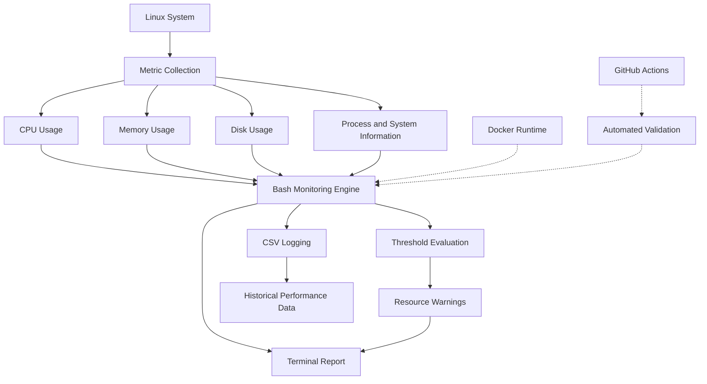
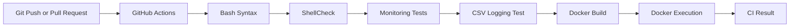

# Server Performance Stats

[](https://github.com/DarshKParikh/Server-Performance-Stats/actions/workflows/ci.yml)


A lightweight, containerised Linux server monitoring tool built with Bash. It provides real-time visibility into system performance, configurable resource alerts, continuous monitoring and historical CSV logging.

Designed to demonstrate practical infrastructure engineering, Linux system administration, automation and DevOps principles.

---

## Overview

Server Performance Stats is a command-line monitoring utility that collects and analyses key Linux system metrics, helping users identify resource utilisation issues and potential performance bottlenecks.

The project has evolved from a basic system statistics script into a configurable monitoring tool with Docker support, historical data collection and an automated continuous integration pipeline.

## Features

| Feature | Description |
|---------|-------------|
| CPU Monitoring | Calculates CPU utilisation using `/proc/stat` |
| Memory Monitoring | Reports system memory utilisation |
| Disk Monitoring | Displays disk usage for a configurable filesystem path |
| Process Monitoring | Identifies the top 5 processes by CPU and memory consumption |
| Continuous Monitoring | Collects performance metrics at configurable intervals |
| Threshold Alerts | Generates warnings when resource usage reaches configured limits |
| CSV Logging | Records timestamped metrics for historical analysis |
| System Information | Displays hostname, kernel version, uptime, load averages and operating system |
| Graceful Shutdown | Stops continuous monitoring safely using Ctrl+C |
| Docker Support | Provides a reproducible Linux runtime environment |
| Automated Testing | Validates code quality and functionality using GitHub Actions |

---

## Architecture



The monitoring engine collects system metrics, evaluates configurable resource thresholds and presents the results through a terminal report. Optional CSV logging stores historical readings for further analysis.

Docker provides a consistent Linux environment, while GitHub Actions automatically validates changes to the project.

---

## Technology Stack

| Technology | Purpose |
|------------|---------|
| Bash | Core monitoring logic and command-line interface |
| Linux | System metrics and process information |
| `/proc/stat` | CPU utilisation sampling |
| `procps` | Process monitoring and system utilities |
| Docker | Containerisation and reproducible execution |
| GitHub Actions | Continuous integration and automated testing |
| ShellCheck | Static analysis of Bash scripts |
| CSV | Historical performance data storage |
| Git | Version control |

---

## Getting Started

### Prerequisites

For native execution:

- Linux operating system
- Bash
- Standard Linux utilities
- `procps`

For macOS or Windows users, Docker Desktop provides a Linux environment for running the monitoring tool.

### Clone the Repository

```bash
git clone https://github.com/DarshKParikh/Server-Performance-Stats.git

cd Server-Performance-Stats
```

### Run on Linux

Install the required utilities on Ubuntu or Debian:

```bash
sudo apt-get update
sudo apt-get install -y procps coreutils gawk
```

Run the monitoring script:

```bash
bash server-stats.sh
```

Alternatively, make the script executable:

```bash
chmod +x server-stats.sh
./server-stats.sh
```

---

## Docker Setup

The project includes a Dockerfile that packages the monitoring script and its dependencies into a reusable container image.

### Build the Image

```bash
docker build -t server-monitor .
```

### Run the Container

```bash
docker run --rm server-monitor
```

### Continuous Monitoring

```bash
docker run --rm -it server-monitor --watch --interval 5
```

Press `Ctrl+C` to stop monitoring.

### Custom Resource Alerts

```bash
docker run --rm server-monitor --cpu 80 --memory 75 --disk 90
```

### Persistent CSV Logging

Create a directory for monitoring data:

```bash
mkdir -p data
```

Run the container with a mounted volume:

```bash
docker run --rm -it \
  -v "$PWD/data:/data" \
  server-monitor \
  --watch --interval 5 --log /data/metrics.csv
```

The CSV file will be saved to `data/metrics.csv` on the host machine and will remain available after the container stops.

> **Note:** When running on Docker Desktop, the reported metrics describe the Linux environment available to the container, rather than directly monitoring the macOS or Windows host. Container process visibility and resource reporting may differ from native Linux execution.

---

## Usage

### Single Performance Report

```bash
bash server-stats.sh
```

### Continuous Monitoring

```bash
bash server-stats.sh --watch
```

### Custom Monitoring Interval

```bash
bash server-stats.sh --watch --interval 5
```

Collects metrics repeatedly, with a five-second delay between monitoring cycles.

### Configurable Threshold Alerts

```bash
bash server-stats.sh --cpu 80 --memory 75 --disk 90
```

Generates warnings when CPU, memory or disk utilisation reaches the specified thresholds.

### Monitor a Specific Filesystem

```bash
bash server-stats.sh --path /home
```

### Historical CSV Logging

```bash
bash server-stats.sh --watch --interval 5 --log metrics.csv
```

### Combined Monitoring Configuration

```bash
bash server-stats.sh \
  --watch \
  --interval 5 \
  --cpu 80 \
  --memory 75 \
  --disk 90 \
  --log metrics.csv
```

### Help

```bash
bash server-stats.sh --help
```

---

## Command-Line Options

| Option | Description |
|--------|-------------|
| `--watch` | Enable continuous monitoring |
| `--interval N` | Set the delay between monitoring cycles in seconds |
| `--cpu N` | Set the CPU warning threshold percentage |
| `--memory N` | Set the memory warning threshold percentage |
| `--disk N` | Set the disk warning threshold percentage |
| `--path PATH` | Select the filesystem path to monitor |
| `--log FILE` | Enable CSV logging to the specified file |
| `--help`, `-h` | Display usage information |

---

## Example Output

```text
========================================
    SERVER PERFORMANCE STATS v2.0
========================================

Timestamp: 2026-11-13T17:59:51Z

CPU Usage:    0.12%
Memory Usage: 13.89%
Disk Usage:   1% (/)

Threshold Alerts
----------------
[WARNING] CPU usage: 0.12% (limit: 0%)
[WARNING] Memory usage: 13.89% (limit: 1%)
[WARNING] Disk usage: 1% (limit: 1%)

Top 5 Processes by CPU Usage
---------------------------
PID    USER    %CPU    %MEM    COMMAND
1      root    0.0     0.0     bash
829    root    0.0     0.0     bash
843    root    0.0     0.0     ps
844    root    0.0     0.0     awk

System Information
------------------
Kernel: 7.0.12-linuxkit
Uptime: up 4 minutes
OS: Ubuntu 24.04.4 LTS
```

The example above uses deliberately low resource thresholds to demonstrate alert functionality. Actual readings depend on the system being monitored.

---

## Historical Performance Data

The monitoring tool supports CSV logging for storing timestamped performance readings.

Example CSV output:

```csv
timestamp,cpu_percent,memory_percent,disk_percent
2026-11-13T18:03:46Z,0.12,14.84,1
2026-11-13T18:03:52Z,0.00,14.86,1
2026-11-13T18:03:58Z,0.12,13.83,1
```

This data can be used for:

- Analysing historical resource utilisation
- Identifying performance trends
- Investigating resource bottlenecks
- Creating performance visualisations
- Supporting future monitoring dashboard integrations

Generated CSV and log files are excluded from version control using `.gitignore`.

---

## Automated Testing and Continuous Integration

The project uses GitHub Actions to automatically validate changes on every push and pull request.

The CI pipeline performs the following checks:

| Check | Purpose |
|-------|---------|
| Bash Syntax Validation | Detects syntax errors using `bash -n` |
| ShellCheck | Identifies Bash scripting issues through static analysis |
| Monitoring Output Test | Verifies CPU, memory and disk metrics are displayed |
| CSV Logging Test | Confirms the script creates a valid logging file with a header and data row |
| Docker Build | Validates that the container image builds successfully |
| Docker Execution | Confirms the monitoring tool runs inside the container |

### CI Pipeline



The workflow configuration is located at:

```text
.github/workflows/ci.yml
```

View the latest workflow results:

[GitHub Actions - Server Monitor CI](https://github.com/DarshKParikh/Server-Performance-Stats/actions)

---

## Project Structure

```text
Server-Performance-Stats/
├── .github/
│   └── workflows/
│       └── ci.yml
├── .gitignore
├── Dockerfile
├── README.md
└── server-stats.sh
```

| File | Purpose |
|------|---------|
| `server-stats.sh` | Core monitoring logic and command-line interface |
| `Dockerfile` | Container image configuration |
| `.github/workflows/ci.yml` | Automated CI workflow |
| `.gitignore` | Excludes generated data and system files |
| `README.md` | Project documentation |

---

## Engineering Decisions

### Lightweight Monitoring

Bash and standard Linux utilities were chosen to minimise external dependencies and provide a simple monitoring solution without requiring a full monitoring platform.

### Configurable Alerting

Resource thresholds can be adjusted through command-line arguments, allowing the monitoring tool to adapt to different environments and workloads.

### Reproducible Execution

Docker packages the application and its dependencies into a consistent Linux environment, simplifying installation and testing across different development machines.

### Automated Quality Checks

GitHub Actions and ShellCheck provide automated validation, helping detect scripting issues and prevent regressions when new features are introduced.

### Historical Data Collection

CSV logging separates data collection from visualisation, allowing monitoring results to be analysed using external tools or integrated into future dashboards.

---

## Skills Demonstrated

This project demonstrates practical experience in:

- Linux system administration and performance monitoring
- Bash scripting and command-line automation
- System resource analysis and process inspection
- Configurable alerting and historical data collection
- Docker containerisation
- Continuous integration using GitHub Actions
- Static code analysis and automated testing
- Git version control and technical documentation

---

## Roadmap

### Completed

- [x] CPU, memory and disk monitoring
- [x] Top process identification
- [x] System information reporting
- [x] Continuous monitoring
- [x] Configurable resource thresholds
- [x] Historical CSV logging
- [x] Graceful shutdown
- [x] Docker containerisation
- [x] Automated CI pipeline

### Planned Improvements

- [ ] Prometheus metrics integration
- [ ] Grafana performance dashboard
- [ ] Docker Compose monitoring stack
- [ ] Additional automated tests for alert thresholds
- [ ] Network utilisation monitoring
- [ ] Email or webhook alert notifications

---

## Author

**Darsh Parikh**

Developed as a hands-on infrastructure and DevOps project to explore Linux performance monitoring, automation, containerisation and reliable software development practices.

[GitHub Profile](https://github.com/DarshKParikh)

---

## Project Inspiration

Inspired by the Server Performance Stats project from [roadmap.sh](https://roadmap.sh/projects/server-stats), extended with continuous monitoring, configurable alerting, historical logging, Docker support and automated testing.
